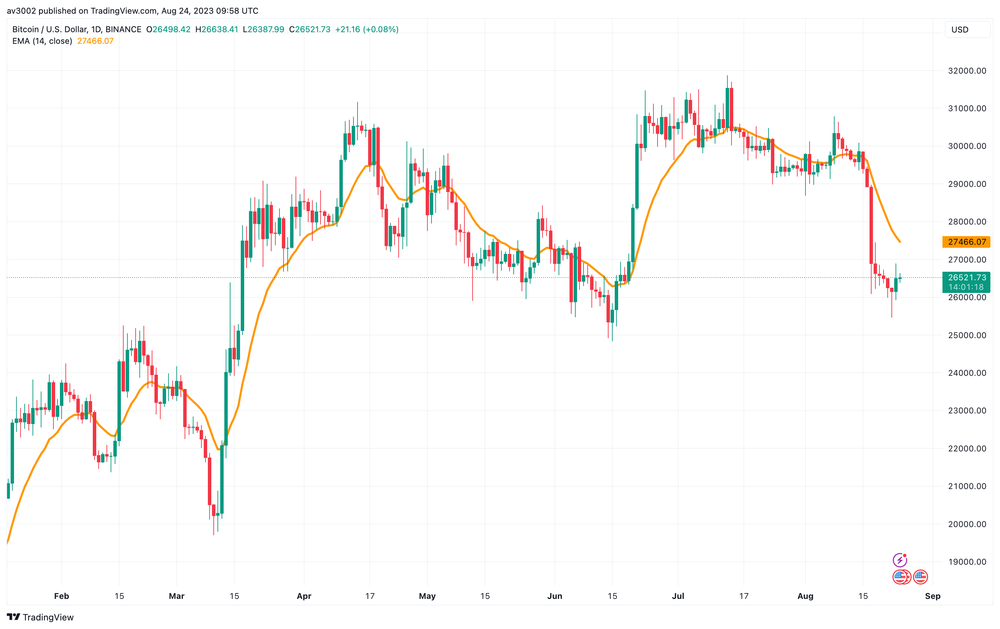
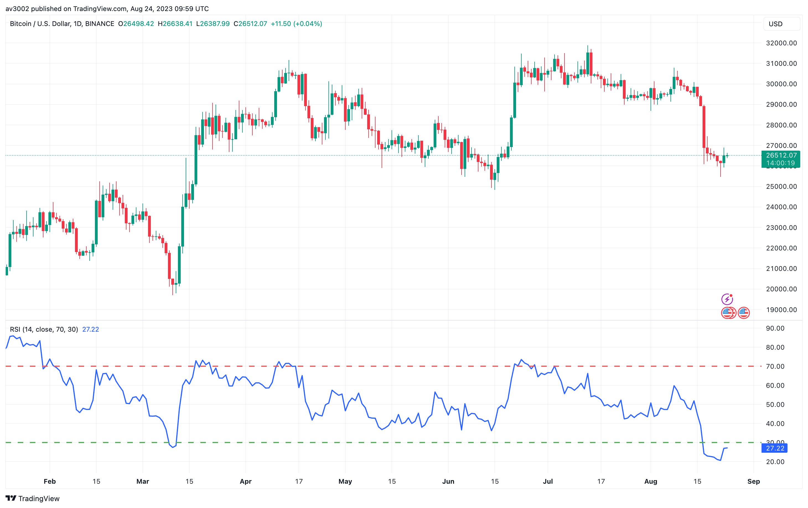
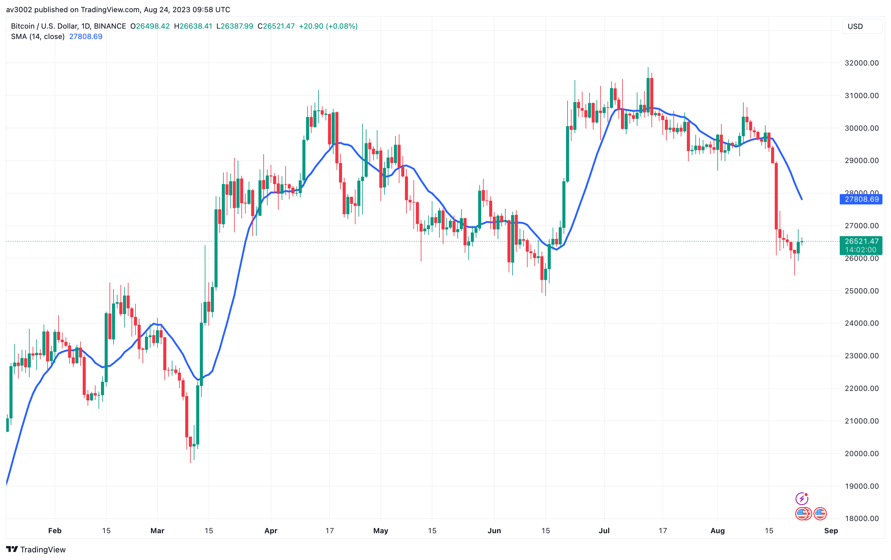
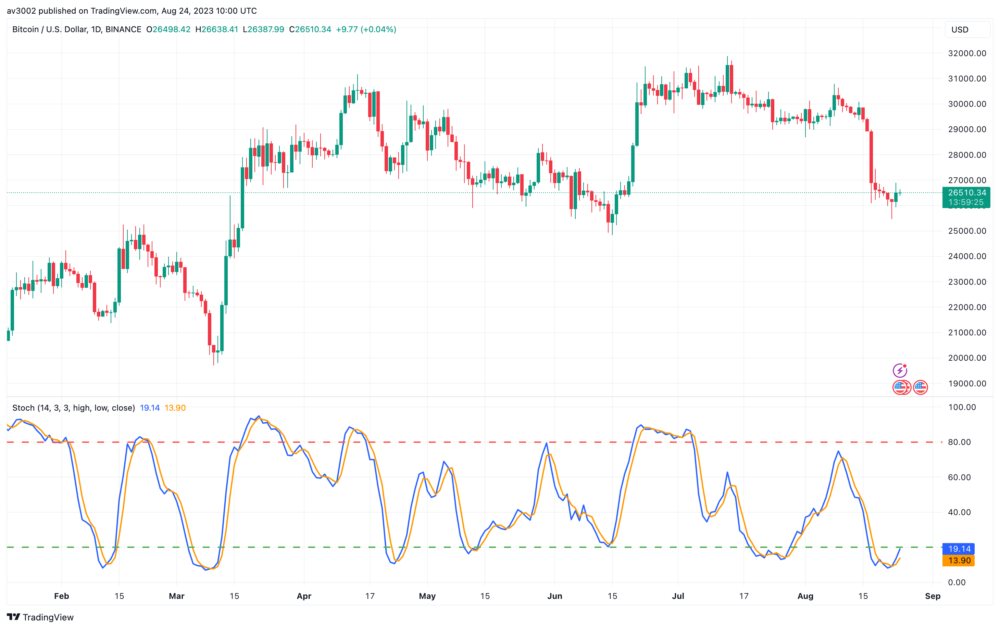
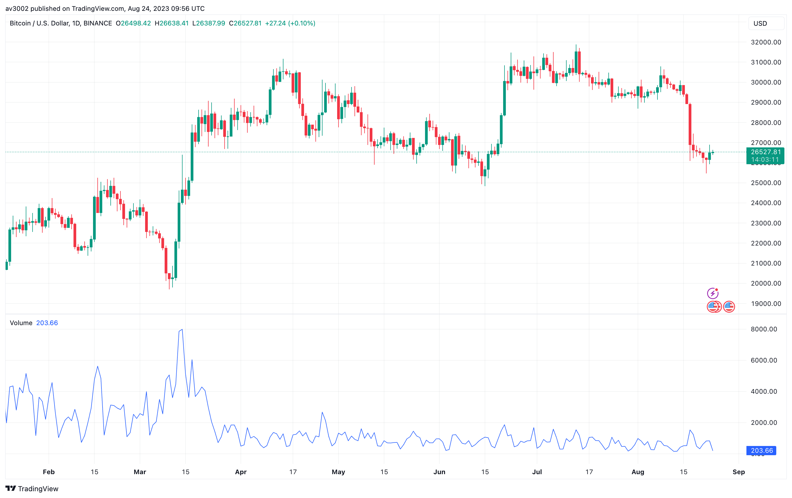

# Pine Strategy Indicators v1

Five open-source TradingView indicators written in Pine Script v6: Exponential Moving Average, Relative Strength Index, Simple Moving Average, Stochastic Oscillator and Trading Volume. Part of [GAINZ](https://gainz-trading-indicators.vercel.app), 35 indicators across seven collections.

| Indicator                                                 | Type     | Script                                                                          |
| --------------------------------------------------------- | -------- | ------------------------------------------------------------------------------- |
| [Exponential Moving Average](#exponential-moving-average) | Trend    | [`exponential-moving-average.pine`](indicators/exponential-moving-average.pine) |
| [Relative Strength Index](#relative-strength-index)       | Momentum | [`relative-strength-index.pine`](indicators/relative-strength-index.pine)       |
| [Simple Moving Average](#simple-moving-average)           | Trend    | [`simple-moving-average.pine`](indicators/simple-moving-average.pine)           |
| [Stochastic Oscillator](#stochastic-oscillator)           | Momentum | [`stochastic-oscillator.pine`](indicators/stochastic-oscillator.pine)           |
| [Trading Volume](#trading-volume)                         | Volume   | [`trading-volume.pine`](indicators/trading-volume.pine)                         |

## Exponential Moving Average

An average that gives recent prices more weight, so it turns sooner than a simple average.

Price above a rising EMA is an uptrend in plain sight. Pair a short and a long one to trade the crossovers.

| Setting | Default |
| ------- | ------- |
| Length  | 14      |
| Source  | Close   |

## Relative Strength Index

Weighs the size of recent gains against recent losses on a scale from 0 to 100.

Above 70 is overbought, below 30 oversold. In strong trends it can stay there for a while, so watch for divergence too.

| Setting    | Default |
| ---------- | ------- |
| Length     | 14      |
| Overbought | 70      |
| Oversold   | 30      |

## Simple Moving Average

The plain average of the last 14 closes. Nothing more, nothing less.

Slow and steady. Use it to define the trend and to see where price keeps finding support.

| Setting | Default |
| ------- | ------- |
| Length  | 14      |
| Source  | Close   |

## Stochastic Oscillator

Shows where the close sits inside the recent high–low range, from 0 to 100.

%K crossing %D above 80 or below 20 marks a likely turn. It shines in ranges; strong trends can pin it to the edges.

| Setting      | Default |
| ------------ | ------- |
| Length       | 14      |
| %K smoothing | 3       |
| %D smoothing | 3       |

## Trading Volume

Relative volume: each bar's volume divided by its 20-bar average, with busier-than-usual bars painted green on the chart.

Above 1 is more activity than normal. Breakouts on high relative volume tend to hold; moves on thin volume often fade.

| Setting   | Default  |
| --------- | -------- |
| Average   | SMA 20   |
| Highlight | Above 1× |

## How to use

1. Open the indicator's `.pine` file in `indicators/` and copy the code.
2. In TradingView, open the Pine Editor, paste the code and save it.
3. Click **Add to chart**, then change the defaults in the indicator's settings.

## Disclaimer

For learning and research. Indicators describe what price has done, not what it will do. Nothing here is financial advice.

## License

[MIT](LICENSE). Indicators based on someone else's work keep their original author's terms.
